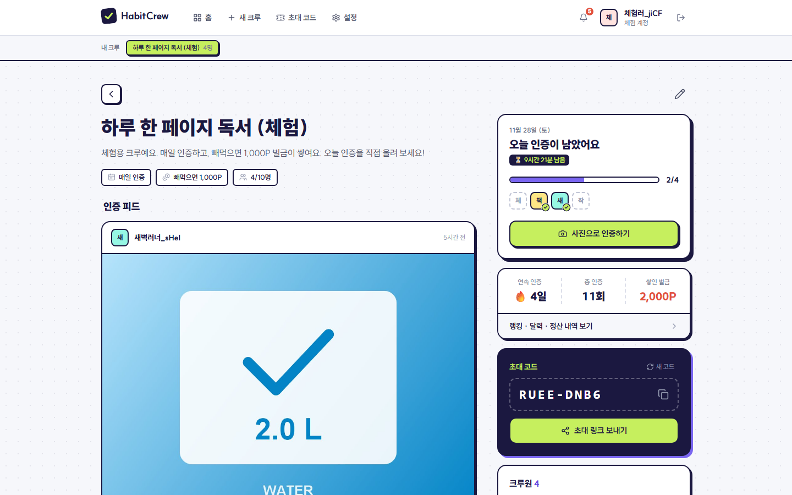
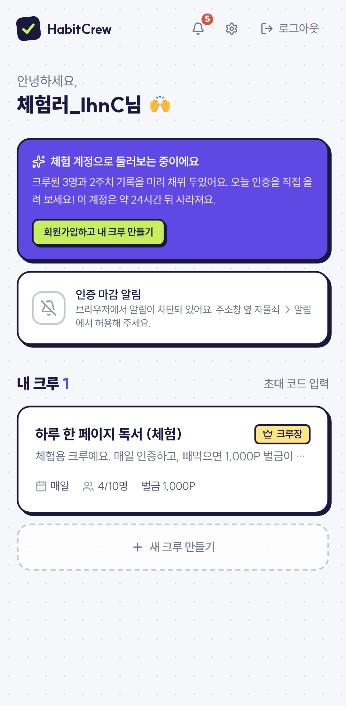
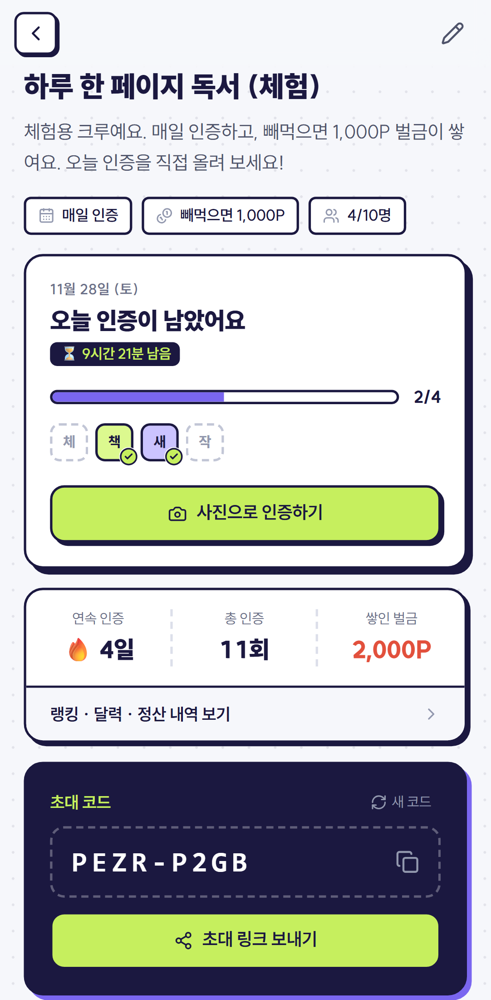
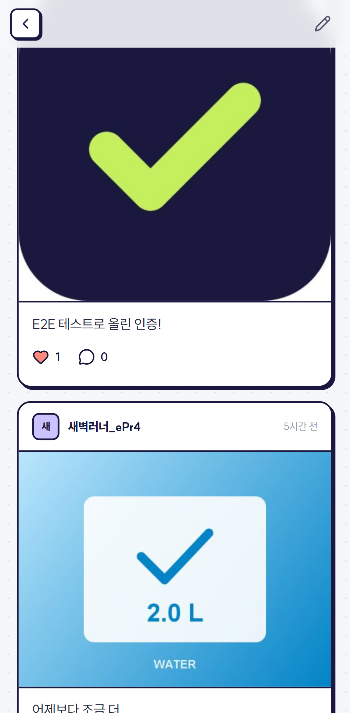
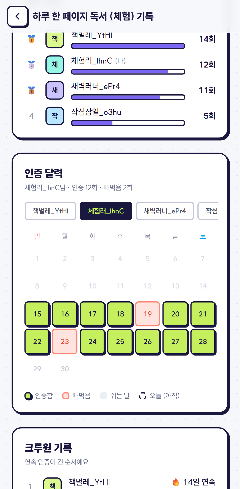
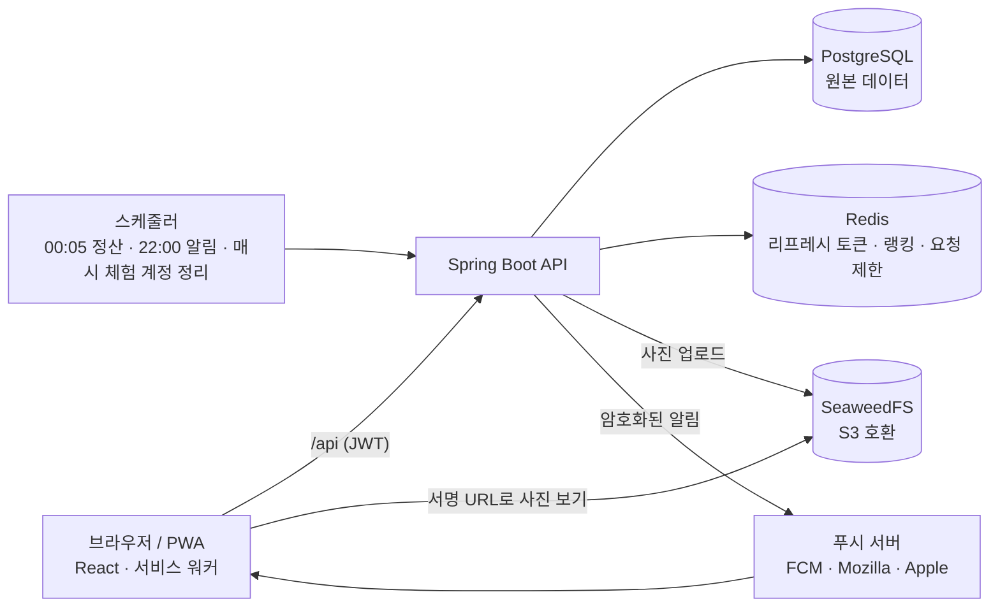

# HabitCrew 🌱

> 크루와 함께 매일 사진으로 인증하고, 빼먹으면 벌금 포인트가 쌓이는 습관 인증 서비스

  
  
  
  

데스크톱에서는 위쪽 메뉴와 두 칸 화면, 휴대폰에서는 한 줄 화면으로 바뀝니다(반응형). 휴대폰 홈 화면에 앱처럼 설치할 수도 있습니다(PWA).

**디자인 콘셉트: 습관 노트와 도장**: 모눈 노트 배경, 굵은 잉크 테두리에 살짝 밀린 그림자(스티커처럼 눌리는 버튼), 완료하면 라임색 도장. 색은 잉크(남색)·바이올렛·라임·코랄, 글꼴은 SUIT.

## 바로 체험하기

로그인 화면의 **"로그인 없이 둘러보기"** 버튼을 누르면 회원가입 없이 바로 써 볼 수 있습니다.
크루원 3명과 2주치 인증·좋아요·댓글·정산 기록이 채워진 체험 크루가 만들어져서, 랭킹·달력·연속 인증·벌금 화면이 처음부터 다 보입니다.
오늘 인증은 비워 두었으니 사진을 직접 올려 보세요. 체험 계정은 24시간 뒤 자동으로 사라집니다.

## 주요 기능

- **크루**: 인증 요일·벌금·정원을 정해 만들고, 초대 코드·링크로 친구를 부른다
- **사진 인증**: 인증일마다 사진 한 장. 오늘의 인증 현황과 마감까지 남은 시간을 보여 준다
- **피드**: 크루원 인증을 최신순으로 보고 좋아요·댓글로 응원한다
- **자정 정산**: 매일 0시 5분, 인증을 빼먹은 크루원에게 벌금 포인트를 매긴다
- **기록**: 연속 인증(🔥), 월간 랭킹, 인증 달력(잔디), 날짜별 정산 내역
- **알림함**: 댓글·좋아요·벌금·새 크루원 소식을 앱 안 종 모양 알림함에서 모아 보기 (안 읽은 개수 배지)
- **알림·앱 설치**: 밤 10시 마감 알림(웹 푸시), 휴대폰 홈 화면에 앱처럼 설치(PWA)
- **계정**: 비밀번호 찾기(메일 링크), 비밀번호·닉네임 바꾸기, 댓글·좋아요 알림 설정, 탈퇴
- **신고**: 부적절한 인증 사진 신고, 크루원 2명 또는 크루장이 신고하면 가려짐

## 기술 스택

| 영역 | 기술 |
|---|---|
| 백엔드 | Java 21, Spring Boot 4, Spring Security (JWT), JPA, Flyway |
| 데이터 | PostgreSQL 17, Redis 7, SeaweedFS (S3 호환 사진 저장소, AWS SDK v2) |
| 프론트엔드 | React 19, TypeScript, Vite, TanStack Query, Tailwind CSS 4, PWA |
| 테스트 | JUnit 5, Testcontainers (실제 PostgreSQL·Redis·SeaweedFS), Playwright E2E |
| CI | GitHub Actions (백엔드 테스트, 웹 타입 검사·빌드, E2E) |

## 구조

## 문제 → 해결 → 결과

| 문제 | 해결 | 결과 (테스트·측정) |
|---|---|---|
| 정원이 1자리 남았을 때 여러 명이 동시에 참여하면 정원을 넘는다 | 참여할 때 크루 행에 `SELECT ... FOR UPDATE` 잠금 | 남은 2자리에 10명 동시 참여 → 정확히 2명. **잠금을 빼면 10명 모두 들어가 테스트가 실패하는 것까지 확인** |
| 23:59:50에 올리기 시작한 사진이 자정을 넘겨 끝나면 다음 날 인증이 된다 | 요청 본문을 읽기 전 필터에서 **도착 시각**을 기록해 그 날짜(KST)로 인증 | 시계를 화요일 00:00:05로 옮기고 월요일 23:59:59 요청을 처리 → 월요일 인증 |
| 정산이 두 번 돌면 벌금도 두 번 매겨진다 (재시작, 서버 여러 대) | 정산 기록 기본 키로 먼저 "찜" + 벌금 유니크 제약 + PostgreSQL 어드바이저리 락 | 5개 스레드 동시 정산 → 한 번만. 재실행 3번 → 0건 추가 |
| 배포 중이라 자정에 서버가 꺼져 있으면 그날 정산을 놓친다 | 서버가 뜰 때·매일 돌 때 최근 7일 중 안 한 날을 모두 따라잡기 | 실제로 PC가 꺼졌다 켜진 날 이틀치가 자동 정산됨 |
| 피드를 OFFSET으로 넘기면 뒤 페이지일수록 느려진다 | `id < 마지막 id` 커서 + `(crew_id, id DESC)` 인덱스 | 인증 20만 건에서 19만 번째 페이지: **OFFSET 64ms → 커서 0.12ms (약 500배)** |
| 목록마다 쿼리를 한 번씩 더 보내는 N+1 | `join fetch`, 집계 쿼리 한 번, `default_batch_fetch_size` | 크루원 2명·10명일 때 화면마다 SQL 수가 같음을 테스트로 고정. 일부러 N+1을 넣으면 5번 → 13번으로 늘어 테스트가 잡아냄 |
| 스마트폰 원본 사진(5MB)을 그대로 쓰면 느리고 데이터가 많이 든다 | 브라우저에서 1600px로 줄여 올리고, 서버가 1600px·480px 썸네일로 다시 저장 | 5.0MB → 170KB(크게 보기). 피드는 썸네일만 받음 |
| 탭 두 개에서 동시에 토큰을 재발급하면 둘 다 로그아웃된다 | 재발급 실패 시 쿠키를 지우지 않고, 실패한 탭은 다른 탭이 갱신한 쿠키로 재시도 | 동시 재발급 테스트: 한쪽만 성공, 이긴 쪽 토큰은 계속 사용 가능 |
| 사용자가 보낸 푸시 구독 주소로 서버가 요청을 보낸다 (SSRF) | https + 알려진 푸시 서버 도메인만 허용, 리다이렉트 안 따라감 | `169.254.169.254`, `fcm.googleapis.com.evil.com` 등 5가지 주소 거부 테스트 |
| 스케줄러를 켜면 `TaskExecutor` 빈이 두 개가 되어 **서버가 아예 뜨지 않는다** (테스트는 스케줄러를 꺼서 못 잡음) | 사용할 빈을 지정하고, **실제와 같은 설정(스케줄러 모두 켬)으로 뜨는지 보는 테스트**를 추가 | 수정 전에는 이 테스트가 실패하고 수정 후 통과하는 것까지 확인 |
| 한글이 들어간 이메일로 가입하면 메일 서버가 주소를 거부해 비밀번호 찾기 메일을 받을 수 없다 (E2E로 발견) | 가입할 때 ASCII 이메일만 받기 | 가입 거부 테스트, Mailpit으로 실제 메일을 받아 링크로 비밀번호를 바꾸는 E2E |
| 비밀번호 찾기에서 가입한 이메일만 응답이 느리면 가입 여부가 드러난다 | 가입 여부와 상관없이 같은 응답(202), 메일은 따로(비동기로) 발송 | 없는 이메일도 202, 메일은 가지 않음(테스트) |

### 계정·알림·운영
- **비밀번호 찾기**: 30분짜리 1회용 링크를 메일로 보냅니다. Redis에는 토큰 원문이 아닌 해시만 두고, 쓰면 `GETDEL`로 바로 지웁니다. 같은 이메일로는 1시간에 3번까지만 보냅니다(메일 폭탄 방지). 가입 여부와 상관없이 같은 응답을 주고 메일은 비동기로 보내서, 응답 내용이나 속도로 가입 여부를 알 수 없습니다.
- **비밀번호를 바꾸면 모든 기기 로그아웃**: 사용자별 리프레시 토큰 목록(Redis Set)을 두어 한 번에 폐기합니다. 지금 쓰는 기기에는 새 토큰을 줘서 로그인 상태를 이어 갑니다.
- **탈퇴**: 행을 지우지 않고 이메일·닉네임·비밀번호를 지운 뒤 탈퇴 시각을 남깁니다. 지난 벌금·정산 기록이 사용자를 가리키기 때문입니다. 내 사진·댓글·좋아요는 지우고(좋아요·댓글 수도 맞춤), 크루원이 남은 크루의 크루장이면 먼저 크루장을 넘기게 합니다. 같은 이메일로 다시 가입할 수 있습니다.
- **예약 닉네임**: "체험러"·"탈퇴한사용자"로 시작하는 이름은 일반 회원이 쓸 수 없습니다(사칭 방지).
- **댓글·좋아요 알림**: 커밋된 뒤 별도 스레드(`@Async` + `@TransactionalEventListener`)에서 보내서, 푸시 서버 응답을 기다리느라 좋아요·댓글이 느려지지 않습니다. 좋아요는 인증 하나당 하루 한 번만 알리고(`notification_log`), 내 반응·알림을 끈 사람에게는 보내지 않습니다.
- **앱 안 알림함**: 푸시는 브라우저 권한·기기에 따라 못 받을 수 있어서, 같은 소식을 `notifications` 테이블에도 남깁니다(활동 알림을 꺼도 알림함에는 남음). 벌금 알림은 정산과 같은 트랜잭션에서 `INSERT … SELECT` 한 문장으로 만들고, 늦게 따라잡아 정산해도 알림 시각은 그날 정산 시각으로 보입니다. 안 읽은 개수는 부분 인덱스(`WHERE read_at IS NULL`)로 세고, 60일 지난 알림은 매일 정리합니다.
- **요청 ID**: 요청마다 ID를 만들어 모든 로그(`MDC`), 응답 헤더 `X-Request-Id`, 에러 응답 `requestId`에 붙입니다. 서버 오류 화면에도 오류 ID를 보여 주므로, 사용자가 알려 주면 그 요청의 로그를 바로 찾을 수 있습니다. 앞단에서 온 ID는 형식이 맞을 때만 이어 씁니다(로그 오염 방지).
- **API 요청 제한**: `@RateLimited(name, limit)`을 붙인 API는 사람(로그인 전이면 IP)마다 1분 단위로 Redis `INCR`로 셉니다. 넘으면 429와 `Retry-After`를 줍니다. 사진 업로드 10회, 댓글 20회, 좋아요 60회, 크루 만들기 5회 등으로 정했습니다.
- **사진 신고**: 같은 사람은 한 번만 신고할 수 있고, 크루원 2명이 신고하거나 크루장이 신고하면 사진을 가립니다. 지우는 것이 아니라 보이지만 않게 해서 인증 기록·정산은 그대로입니다. 가려진 사진의 주소는 크루원에게 내려주지 않고(서버에서 빼고 보냄), 작성자와 크루장만 볼 수 있습니다. 크루장은 다시 보이게 할 수 있습니다.
