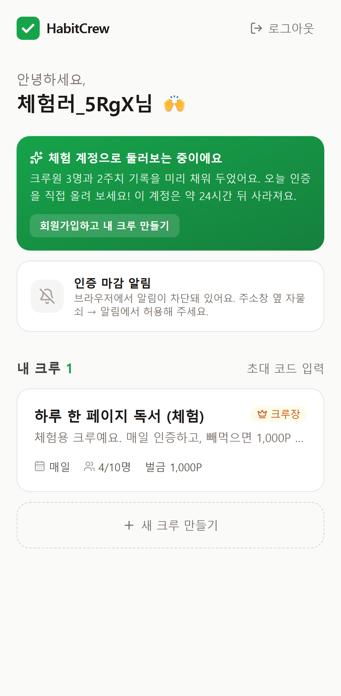
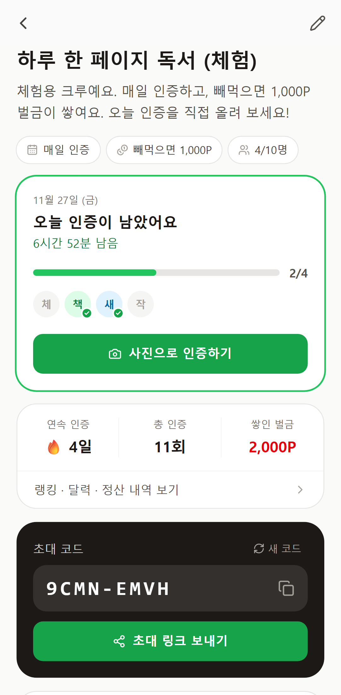
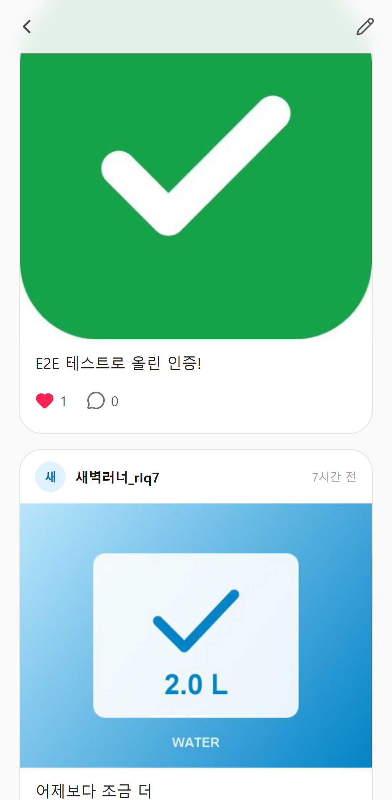
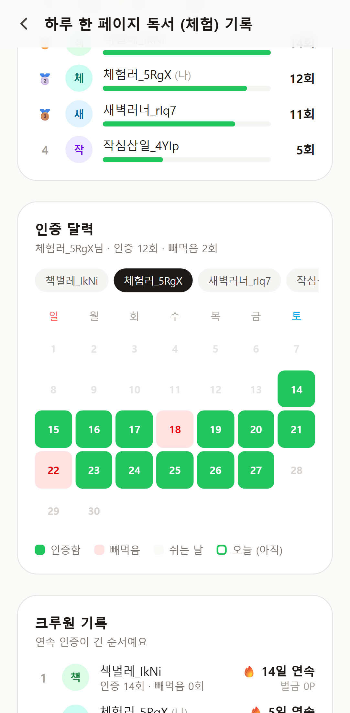
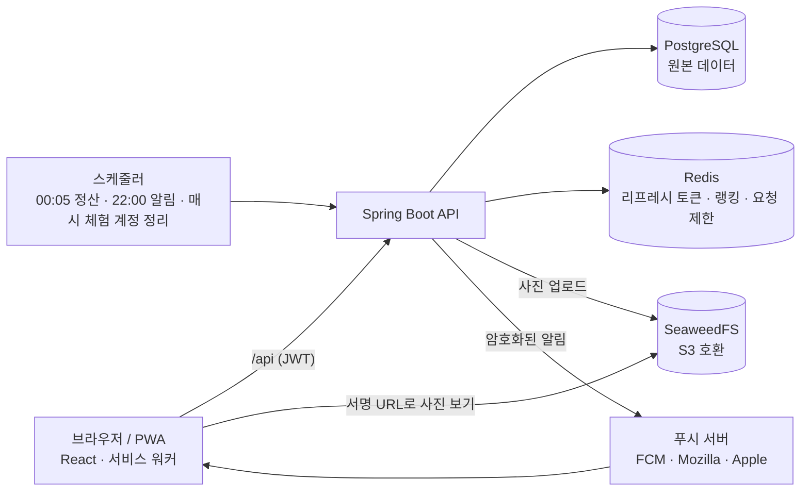

# HabitCrew 🌱

> 크루와 함께 매일 사진으로 인증하고, 빼먹으면 벌금 포인트가 쌓이는 습관 인증 서비스


<p>
  
  
  
  
</p>

## 바로 체험하기

로그인 화면의 **"로그인 없이 둘러보기"** 버튼을 누르면 회원가입 없이 바로 써 볼 수 있습니다.
크루원 3명과 2주치 인증·좋아요·댓글·정산 기록이 채워진 체험 크루가 만들어져서, 랭킹·달력·연속 인증·벌금 화면이 처음부터 다 보입니다.
오늘 인증은 비워 두었으니 사진을 직접 올려 보세요. 체험 계정은 24시간 뒤 자동으로 사라집니다.

## 주요 기능

- **크루**: 인증 요일·벌금·정원을 정해 만들고, 초대 코드·링크로 친구를 부른다
- **사진 인증**: 인증일마다 사진 한 장. 오늘의 인증 현황과 마감까지 남은 시간을 보여 준다
- **피드**: 크루원 인증을 최신순으로 보고 좋아요·댓글로 응원한다
- **자정 정산**: 매일 0시 5분, 인증을 빼먹은 크루원에게 벌금 포인트를 매긴다
- **기록**: 연속 인증(🔥), 월간 랭킹, 인증 달력(잔디), 날짜별 정산 내역
- **알림·앱 설치**: 밤 10시 마감 알림(웹 푸시), 휴대폰 홈 화면에 앱처럼 설치(PWA)

## 기술 스택

| 영역 | 기술 |
|---|---|
| 백엔드 | Java 21, Spring Boot 4, Spring Security (JWT), JPA, Flyway |
| 데이터 | PostgreSQL 17, Redis 7, SeaweedFS (S3 호환 사진 저장소, AWS SDK v2) |
| 프론트엔드 | React 19, TypeScript, Vite, TanStack Query, Tailwind CSS 4, PWA |
| 테스트 | JUnit 5, Testcontainers (실제 PostgreSQL·Redis·SeaweedFS), Playwright E2E |
| CI | GitHub Actions (백엔드 테스트, 웹 타입 검사·빌드) |

## 구조



## 문제 → 해결 → 결과

| 문제 | 해결 | 결과 (테스트·측정) |
|---|---|---|
| 정원이 1자리 남았을 때 여러 명이 동시에 참여하면 정원을 넘는다 | 참여할 때 크루 행에 `SELECT ... FOR UPDATE` 잠금 | 남은 2자리에 10명 동시 참여 → 정확히 2명. **잠금을 빼면 10명 모두 들어가 테스트가 실패하는 것까지 확인** |
| 23:59:50에 올리기 시작한 사진이 자정을 넘겨 끝나면 다음 날 인증이 된다 | 요청 본문을 읽기 전 필터에서 **도착 시각**을 기록해 그 날짜(KST)로 인증 | 시계를 화요일 00:00:05로 옮기고 월요일 23:59:59 요청을 처리 → 월요일 인증 |
| 정산이 두 번 돌면 벌금도 두 번 매겨진다 (재시작, 서버 여러 대) | 정산 기록 기본 키로 먼저 "찜" + 벌금 유니크 제약 + PostgreSQL 어드바이저리 락 | 5개 스레드 동시 정산 → 한 번만. 재실행 3번 → 0건 추가 |
| 배포 중이라 자정에 서버가 꺼져 있으면 그날 정산을 놓친다 | 서버가 뜰 때·매일 돌 때 최근 7일 중 안 한 날을 모두 따라잡기 | 실제로 PC가 꺼졌다 켜진 날 이틀치가 자동 정산됨 |
| 피드를 OFFSET으로 넘기면 뒤 페이지일수록 느려진다 | `id < 마지막 id` 커서 + `(crew_id, id DESC)` 인덱스 | 인증 20만 건에서 19만 번째 페이지: **OFFSET 64ms → 커서 0.12ms (약 500배)** |
| 목록마다 쿼리를 한 번씩 더 보내는 N+1 | `join fetch`, 집계 쿼리 한 번, `default_batch_fetch_size` | 크루원 2명·10명일 때 화면마다 SQL 수가 같음을 테스트로 고정. 일부러 N+1을 넣으면 5번 → 13번으로 늘어 테스트가 잡아냄 |
| 스마트폰 원본 사진(5MB)을 그대로 쓰면 느리고 데이터가 많이 든다 | 브라우저에서 1600px로 줄여 올리고, 서버가 1600px·480px 썸네일로 다시 저장 | 5.0MB → 170KB(크게 보기). 피드는 썸네일만 받음 |
| 탭 두 개에서 동시에 토큰을 재발급하면 둘 다 로그아웃된다 | 재발급 실패 시 쿠키를 지우지 않고, 실패한 탭은 다른 탭이 갱신한 쿠키로 재시도 | 동시 재발급 테스트: 한쪽만 성공, 이긴 쪽 토큰은 계속 사용 가능 |
| 사용자가 보낸 푸시 구독 주소로 서버가 요청을 보낸다 (SSRF) | https + 알려진 푸시 서버 도메인만 허용, 리다이렉트 안 따라감 | `169.254.169.254`, `fcm.googleapis.com.evil.com` 등 5가지 주소 거부 테스트 |

자세한 측정 방법과 표는 [docs/performance.md](docs/performance.md)에 있습니다.

## 테스트

- **백엔드 통합 테스트 68개**: 실제 PostgreSQL·Redis·SeaweedFS 컨테이너(Testcontainers)로 API를 끝까지 호출합니다. 시계를 옮겨 자정·요일 경계를 재현하고, 여러 스레드로 동시 요청을 재현합니다.
- **E2E 테스트 (Playwright)**: 휴대폰 화면 크기의 실제 브라우저로 "둘러보기 → 사진 인증 → 좋아요·댓글 → 기록"과 "가입 → 크루 만들기 → 초대 링크로 참여"를 끝까지 눌러 봅니다. 위 스크린샷도 이 테스트가 찍었습니다.
- **성능 측정**: `./gradlew benchmark` (일반 테스트에서는 빠짐)

```powershell
npm run test:api
```

```powershell
npm run test:e2e -w @habitcrew/web
```

E2E는 `dev.cmd`로 서버를 켠 뒤에 돌립니다. 스크린샷을 다시 찍으려면 `SCREENSHOTS=1`을 붙입니다.

## 실행 방법

1. Docker Desktop을 켭니다.
2. `dev.cmd`를 더블클릭합니다. (또는 `npm install` 후 `npm run dev`)
3. 브라우저에서 http://localhost:5180 을 엽니다.

| 주소 | 용도 |
|---|---|
| http://localhost:5180 | 웹 앱 |
| http://localhost:8090/swagger-ui.html | API 문서 |

다른 프로젝트와 동시에 켜도 충돌하지 않도록 포트를 따로 씁니다: PostgreSQL 5434, Redis 6381, 사진 저장소 8333, 백엔드 8090, 웹 5180.

`infra/seaweedfs/s3.json`과 `docker-compose.yml`의 접근 키·비밀번호는 로컬 개발 전용입니다. 배포할 때는 환경 변수(`STORAGE_ACCESS_KEY` 등)로 실제 값을 넣습니다.

자정 정산을 기다리지 않고 바로 돌려 보려면 (local 프로필 전용, 로그인 토큰 필요): `POST /api/dev/settlements/run` (밀린 정산 전체) 또는 `?date=2026-11-23` (그날만)

로컬 확인용 테스트 계정 (로컬 DB에만 있음, 비밀번호는 둘 다 `Habit1234`): `demo@habitcrew.test`, `friend@habitcrew.test`

## 개발 단계

- [x] **1단계: 기반**: 모노레포, Docker Compose, 회원가입·로그인 (JWT + 리프레시 토큰 회전)
- [x] **2단계: 그룹**: 크루 생성, 초대 코드·링크, 크루장 넘기기, 내보내기, 나가기
- [x] **3단계: 인증**: 사진 업로드, 오늘의 인증 현황, 피드, 좋아요·댓글
- [x] **4단계: 정산**: 자정 정산 스케줄러, 밀린 정산 따라잡기, 벌금 포인트, 연속 인증 일수, 정산 내역
- [x] **5단계: 랭킹·알림**: Redis 월간 랭킹, 인증 달력(잔디), PWA(홈 화면 설치), 웹 푸시 마감 알림
- [x] **체험 계정**: 로그인 없이 둘러보기 (방문자마다 따로 쓰는 체험 크루, 24시간 뒤 자동 정리)
- [x] **6단계: 품질**: N+1 쿼리 테스트, 성능 측정, Playwright E2E, GitHub Actions CI, 크루 삭제 시 사진 정리

### 알려진 한계
- 웹 푸시의 실제 수신은 크롬에서 직접 확인해야 합니다(아래 "푸시 알림 직접 확인하기"). 자동 테스트는 암호문을 RFC 순서대로 풀고 서명을 검증하는 데까지입니다.
- 배포는 아직 하지 않았습니다. 사진 저장소·VAPID 키·JWT 비밀값은 환경 변수로 바꿔 넣도록 준비돼 있습니다.

## 설계 메모

### 인증 (1단계)
- **액세스 토큰**(30분)은 브라우저 메모리에만 둡니다. localStorage에 두면 XSS 공격으로 탈취될 수 있기 때문입니다.
- **리프레시 토큰**(14일)은 `HttpOnly; SameSite=Strict; Path=/api/auth` 쿠키로만 주고받습니다. JavaScript가 읽을 수 없고, 다른 사이트에서 시작된 요청에는 실리지 않습니다.
- 리프레시 토큰은 Redis에 **SHA-256 해시로 저장**하고, 쓸 때 `GETDEL`로 꺼내면서 지웁니다. 같은 토큰을 두 번 쓰면 두 번째는 실패합니다(토큰 회전).
- 프론트에서 여러 요청이 동시에 401을 받아도 **재발급 요청은 한 번만** 보내도록 Promise를 공유합니다. React StrictMode에서 effect가 두 번 실행돼도 토큰이 꼬이지 않는 이유이기도 합니다.
- **탭 두 개 동시 재발급** (4단계에서 발견해 고침): 탭 두 개가 같은 리프레시 토큰으로 동시에 재발급하면 한쪽은 실패합니다. 처음에는 실패한 쪽 응답이 쿠키를 지웠는데, 그러면 이긴 탭이 방금 받은 새 쿠키까지 지워져 **둘 다 로그아웃**됐습니다. 이제 실패해도 쿠키를 지우지 않고, 실패한 탭은 0.3초 뒤 다른 탭이 갱신한 쿠키로 한 번 더 시도합니다(동시 재발급 테스트 추가).
- 같은 이메일로 **5번 틀리면 10분 잠금**됩니다(Redis `INCR` + TTL). 가입되지 않은 이메일도 같은 시간만큼 비밀번호를 비교해서, 응답 속도로 가입 여부를 알아낼 수 없게 했습니다.
- 이메일 중복은 애플리케이션에서 먼저 검사하고, 동시에 가입 요청이 와서 검사를 통과하더라도 **DB 유니크 제약**에서 한 번 더 막습니다.

### 크루 (2단계)
- **정원 초과 방지 (동시성)**: 마지막 한 자리에 여러 명이 동시에 참여하면, 각자 "아직 자리가 있다"고 읽고 모두 들어가 정원을 넘을 수 있습니다. 참여할 때 크루 행에 `SELECT ... FOR UPDATE` 잠금을 걸어 인원을 한 명씩 차례로 세게 했습니다.
  - 검증: 남은 자리 2개에 10명이 동시에 참여하는 테스트에서 정확히 2명만 성공합니다. **잠금을 빼고 돌리면 10명 모두 들어가 테스트가 실패하는 것**까지 확인했습니다.
- **연타 방지**: 같은 사람이 참여 버튼을 여러 번 눌러도 잠금과 `(crew_id, user_id)` 유니크 제약이 이중으로 막아 한 번만 참여됩니다.
- **초대 코드**: 8자리, 헷갈리는 글자(0/O, 1/I/L)를 뺀 31개 문자로 만들어 약 8,500억 가지입니다. `SecureRandom`으로 만들어 예측할 수 없고, 소문자·공백·하이픈이 섞여 입력돼도 받아 줍니다. 코드가 퍼지면 크루장이 새 코드로 바꿀 수 있습니다.
- **인증 요일 비트마스크**: 월=1, 화=2, ... 일=64로 정수 하나에 저장합니다. 정산 때 "오늘이 인증일인가"를 비트 연산 한 번으로 판단합니다.
- **규칙 고정**: 인증 요일과 벌금은 만든 뒤 바꿀 수 없습니다. 정산 도중 규칙이 바뀌면 크루원끼리 분쟁이 생기기 때문입니다.
- **존재 숨기기**: 크루원이 아닌 사람이 크루 주소로 들어오면 403이 아닌 404를 돌려줘, 크루가 있는지조차 알 수 없게 했습니다.
- **크루장 규칙**: 크루장은 다른 크루원이 있으면 나갈 수 없고, 먼저 크루장을 넘겨야 합니다. 혼자 남은 크루장이 나가면 크루가 사라집니다.
- **초대 링크**: 로그인하지 않은 사람이 `/join/코드` 링크를 열면, 로그인이나 가입을 마친 뒤 초대 화면으로 돌아옵니다.

### 사진 인증 (3단계)
- **자정 경계 문제**: 23:59:50에 올리기 시작한 사진이 업로드에 15초가 걸리면, 처리 시각(00:00:05) 기준으로는 "다음 날 인증"이 됩니다. 요청 본문을 읽기 전에 도는 서블릿 필터에서 **도착 시각**을 기록하고, 그 시각의 날짜(KST)로 인증일을 정합니다.
  - 검증: 시계를 화요일 00:00:05로 옮겨 두고 월요일 23:59:59에 도착한 요청을 처리하면, 월요일 인증으로 저장되는지 테스트합니다.
- **시간대**: 서버가 UTC로 돌아가도 인증 날짜와 마감은 항상 한국 시간 기준입니다. "오늘"은 `ServiceTime` 한곳에서만 계산하고, 테스트도 `-Duser.timezone=Asia/Seoul`로 고정합니다.
- **사진 최적화**: 브라우저가 먼저 긴 변 1600px JPEG로 줄여 올리고(예: 596KB → 94KB), 서버가 다시 1600px 원본과 480px 썸네일로 만듭니다. 피드는 썸네일만, 크게 볼 때만 원본을 받습니다.
- **사진 보안**
  - 파일 이름이나 Content-Type은 속일 수 있어서 **파일 앞부분(매직 바이트)**으로 JPEG·PNG인지 확인합니다.
  - 실제로 그리기 전에 가로·세로부터 읽어 4000만 화소가 넘으면 거절합니다. 작은 파일이 수억 픽셀로 풀리는 "압축 폭탄"을 막기 위해서입니다.
  - 서버가 사진을 새로 그려 저장하므로 **촬영 위치(GPS) 같은 EXIF 정보가 지워집니다.**
  - 저장소 버킷은 공개하지 않습니다. 크루원이 피드를 볼 때마다 서버가 **1시간짜리 서명 URL**을 만들어 줍니다. 서명을 뗀 주소로는 403이 납니다(테스트로 확인).
- **업로드와 트랜잭션 분리**: 사진 변환·업로드는 DB 트랜잭션 밖에서 하고, 저장만 짧은 트랜잭션으로 합니다. 업로드 동안 DB 연결을 붙잡지 않기 위해서입니다. 저장에 실패하면(예: 동시에 두 번 올림) 올려 둔 사진을 지워 주인 없는 파일이 남지 않게 했습니다.
- **하루 한 번**: `(crew_id, user_id, cert_date)` 유니크 제약이 있어서, 동시에 5번 올려도 1개만 저장됩니다(동시성 테스트).
- **좋아요 동시성**: "개수 읽기 → +1 → 쓰기"는 동시에 누르면 숫자가 틀어집니다. `INSERT ... ON CONFLICT DO NOTHING`으로 실제로 새로 눌린 경우에만 `UPDATE ... SET like_count = like_count + 1`을 해서, 10명이 동시에 눌러도 정확히 10이 됩니다. API는 PUT/DELETE라 연타해도 결과가 같고, 화면은 낙관적 업데이트로 바로 반영합니다.
- **피드 페이지네이션**: OFFSET 대신 "마지막으로 본 id보다 작은 것"을 가져오는 커서 방식입니다. 새 인증이 올라와도 같은 글이 두 번 나오지 않고, 뒤 페이지로 갈수록 느려지지 않습니다(`(crew_id, id DESC)` 인덱스).
- **지난 인증은 못 지움**: 오늘 올린 내 인증만 지울 수 있습니다(다시 찍어 올리기용). 지난 인증은 4단계 정산의 근거라서 지울 수 없습니다.

### 자정 정산 (4단계)
- **언제**: 매일 00:05(KST)에 어제를 정산합니다. 자정 직전에 시작한 업로드가 끝날 시간으로 5분을 둡니다(인증 날짜는 요청 도착 시각 기준이라 늦게 끝나도 어제로 들어갑니다).
- **누구에게**: 그날이 인증 요일이고, **그날 0시 이전에 참여한** 크루원 중 인증하지 않은 사람에게 크루 벌금만큼 포인트를 매깁니다. 그날 참여한 사람은 첫날이라 봐줍니다(밤 11시 50분에 들어와 벌금을 받는 일이 없게). 벌금은 정산 시점 값을 복사해 두어 과거 기록이 바뀌지 않습니다.
- **멱등성 (몇 번을 돌려도 결과가 같다)**: 크루·날짜마다 `crew_settlements`의 기본 키 `(crew_id, settle_date)`로 정산 기록을 먼저 "찜"합니다(`INSERT ... ON CONFLICT DO NOTHING`). 이미 있으면 아무것도 하지 않습니다. 벌금도 `(crew_id, user_id, settle_date)` 유니크 제약으로 한 번 더 막습니다.
  - 검증: 같은 날을 여러 번 정산해도, 5개 스레드가 동시에 정산해도 벌금은 한 번만 매겨집니다.
- **서버가 여러 대일 때**: PostgreSQL **어드바이저리 락**(`pg_try_advisory_lock`)으로 한 대만 정산을 돌립니다. 락을 못 잡은 서버는 건너뜁니다. 외부 라이브러리(ShedLock 등) 없이 DB 기능만 썼습니다. 락이 뚫리더라도 위의 멱등성 덕분에 중복 벌금은 생기지 않습니다(이중 방어).
- **밀린 정산 따라잡기**: 배포나 장애로 서버가 자정에 꺼져 있었다면 그날 정산을 놓칩니다. 그래서 매일 돌 때와 **서버가 뜰 때마다** 최근 7일 중 정산 안 된 날을 모두 찾아 오래된 날부터 처리합니다.
  - 검증: 월요일 밤부터 금요일까지 서버가 꺼져 있었다고 가정하면, 금요일에 한 번 돌 때 월·수가 정산되고 화·목(쉬는 날)은 건너뜁니다.
- **크루별 격리**: 크루마다 트랜잭션을 따로 써서 한 크루에서 오류가 나도 다른 크루 정산은 계속됩니다. 실패한 크루는 정산 기록이 롤백돼 "안 한 날"로 남으므로 다음 실행 때 다시 시도됩니다.
- **한 문장 정산**: 대상 조회 → 인증 여부 확인 → 벌금 기록을 `INSERT ... SELECT ... WHERE NOT EXISTS` 한 문장으로 처리해, 크루원이 많아도 쿼리 수가 늘지 않습니다.
- **연속 인증(스트릭)**: 인증 요일만 셉니다. 월·수·금 크루라면 화·목은 쉬는 날이라 끊기지 않습니다. 오늘은 아직 끝나지 않았으므로 오늘 인증 전이어도 어제까지의 기록은 유지됩니다. 크루원 기록은 쿼리 3번으로 모든 크루원을 한꺼번에 계산합니다(N+1 없음).

### 랭킹·달력 (5단계)
- **Redis Sorted Set 월간 랭킹**: `rank:crew:{id}:{yyyy-MM}`에 크루원별 그달 인증 횟수를 점수로 둡니다. 원본은 DB이고 Redis는 정렬된 사본이라, 조회 때 `GROUP BY + ORDER BY` 없이 `ZREVRANGE` 한 번으로 순서를 꺼냅니다.
  - 솔직한 메모: 크루 정원이 30명이라 이 규모에서는 DB로도 충분히 빠릅니다. Sorted Set은 "전체 사용자 랭킹"처럼 대상이 커질 때를 대비한 구조이고, 그때 생기는 캐시 일관성 문제를 미리 다뤄 보는 데 의미를 두었습니다.
- **커밋 후 반영**: 인증이 저장되면 이벤트를 내고, `@TransactionalEventListener`가 **커밋이 끝난 뒤에만** `ZINCRBY` 합니다. 롤백된 인증이 랭킹에 들어가지 않습니다. 오늘 인증을 지우면 1을 뺍니다.
- **캐시가 비었을 때**: Redis 재시작이나 만료로 키가 없으면 다음 조회 때 DB에서 다시 만듭니다. 임시 키에 다 쓴 뒤 `RENAME`으로 한 번에 바꿔서, 반쯤 만들어진 랭킹이 보이지 않게 했습니다.
  - 함정: 키가 없는 동안 `ZINCRBY`를 그대로 하면 빈 키에 1만 더해져 "1회짜리 랭킹"이 완성본처럼 보입니다. 그래서 "준비됨" 표시가 있을 때만 더하도록 **Lua 스크립트로 확인과 증가를 원자적으로** 묶었습니다. 준비 전 인증은 다시 만들 때 DB에서 어차피 셉니다(테스트로 확인).
- **스스로 복구**: Redis 쓰기가 실패하면 "준비됨" 표시를 지워 다음 조회 때 DB에서 다시 만들고, 매일 정산 뒤에도 이번 달 표시를 지워 하루 한 번은 DB와 맞춥니다.
- **인증 달력(잔디)**: 날마다 인증함·빼먹음·쉬는 날·오늘(아직)·미래·참여 전을 구분합니다. 정산과 같은 규칙(참여한 날은 빼먹음이 아님)을 써서 달력과 벌금이 어긋나지 않습니다. 다른 크루원의 달력도 볼 수 있습니다.

### 웹 푸시 알림 (5단계)
- **마감 알림**: 매일 22:00(KST)에 오늘이 인증일인데 아직 안 한 크루가 있는 사람에게 알림을 보냅니다. 크루가 여러 개여도 사람당 하나로 묶고, `notification_log`의 기본 키 `(user_id, kind, ref_date)`로 하루 한 번만 보냅니다(서버가 여러 대여도).
- **표준을 직접 구현**: 메시지 암호화(RFC 8291, aes128gcm)와 서버 서명(VAPID, RFC 8292)을 **외부 라이브러리 없이 JDK 암호 기능**(ECDH P-256, HKDF-SHA256, AES-128-GCM, ES256)으로 구현했습니다. 푸시 서버(구글·모질라·애플)는 내용을 볼 수 없고 구독한 브라우저만 풀 수 있습니다.
  - 테스트는 브라우저 역할을 해서, 키 쌍을 만들어 구독하고 서버가 보낸 암호문을 RFC의 받는 쪽 순서대로 풀어 내용을 확인합니다. VAPID JWT 서명도 공개 키로 검증합니다.
- **VAPID 키 관리**: 환경 변수가 없으면 처음 뜰 때 만들어 DB에 저장합니다. 공개 키와 비밀 키를 **한 줄에 함께** 저장합니다. 두 줄로 나누면 서버 두 대가 동시에 처음 뜰 때 서로 다른 짝이 섞여 저장될 수 있기 때문입니다.
- **SSRF 방지**: 구독 주소(endpoint)는 사용자가 바꿔 보낼 수 있는 값입니다. 아무 주소나 받으면 우리 서버가 그 주소(예: 클라우드 메타데이터 서버)로 요청을 보내게 되므로, **https이면서 알려진 푸시 서버 도메인**일 때만 받고 리다이렉트도 따라가지 않습니다(`fcm.googleapis.com.evil.com` 같은 비슷한 도메인도 테스트로 막음).
- **구독 정리**: 푸시 서버가 404·410(사용자가 알림을 끄거나 앱을 지움)을 주면 그 구독을 지웁니다.
- **PWA**: 매니페스트와 아이콘(일반·maskable·애플)을 넣어 휴대폰 홈 화면에 앱처럼 설치할 수 있습니다. 아이폰은 홈 화면에 추가한 앱에서만 웹 푸시를 받을 수 있어서, 그 안내를 화면에 보여 줍니다. 알림 권한은 페이지를 열자마자 묻지 않고 사용자가 스위치를 켤 때만 묻습니다.

#### 푸시 알림 직접 확인하기 (크롬)
1. 크롬에서 http://localhost:5180 에 로그인합니다. localhost는 https가 아니어도 푸시가 됩니다.
2. 홈의 "인증 마감 알림" 스위치를 켜고 알림 권한을 허용합니다.
3. "시험 알림 보내기"를 누르면 알림이 뜹니다. 알림을 누르면 앱이 열립니다.

### 체험 계정 (로그인 없이 둘러보기)
- **방문자마다 따로 쓰는 모래상자**: 모두가 쓰는 데모 계정 하나를 두면, 누군가 크루를 나가거나 이름을 바꿔 다음 방문자가 망가진 화면을 봅니다. 그래서 버튼을 누를 때마다 체험 계정과 체험 크루를 새로 만듭니다.
- **실제 로직으로 만든 기록**: 가상 크루원 3명의 14일치 인증을 넣은 뒤, 지난 날짜를 **실제 정산 로직**(`SettlementService.settle`)으로 정산합니다. 그래서 벌금·연속 인증·달력이 진짜 규칙대로 쌓입니다.
- **실제 데이터와 섞이지 않게**: 체험 계정은 실제 크루에 참여할 수 없고, 실제 회원도 체험 크루의 초대 코드로 들어올 수 없습니다(코드가 없는 것처럼 404). 체험 계정은 비밀번호로 로그인할 수 없고, 응답에 이메일도 나가지 않습니다.
- **자동 정리**: 매시간 만료된 체험 계정을 지웁니다. 체험 크루를 지우면 크루원·인증·좋아요·댓글·정산·벌금이 `ON DELETE CASCADE`로 함께 지워지고, 체험 중에 직접 올린 사진도 저장소에서 지웁니다.
- **샘플 사진은 한 번만**: 체험 크루의 사진은 처음 한 번만 그려 올리고 모든 체험 계정이 같이 씁니다(저장 공간이 계정 수만큼 늘지 않게). 인증을 지우거나 계정을 정리할 때 샘플 사진은 지우지 않습니다(테스트로 확인). 글자는 숫자·영문만 써서 한글 글꼴이 없는 서버에서도 깨지지 않습니다.
- **남용 방지**: 같은 IP에서 1시간에 10개까지만 만들 수 있습니다(Redis `INCR` + TTL).
